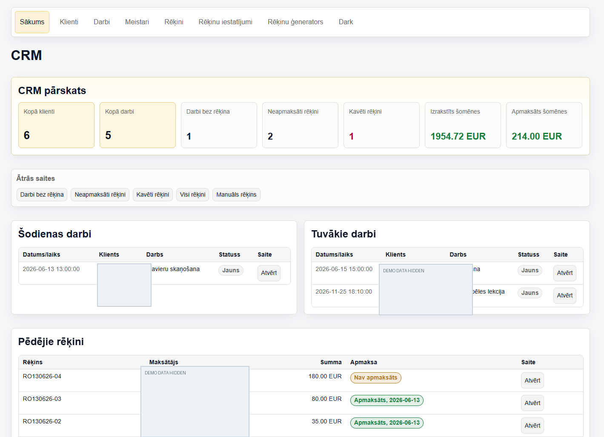
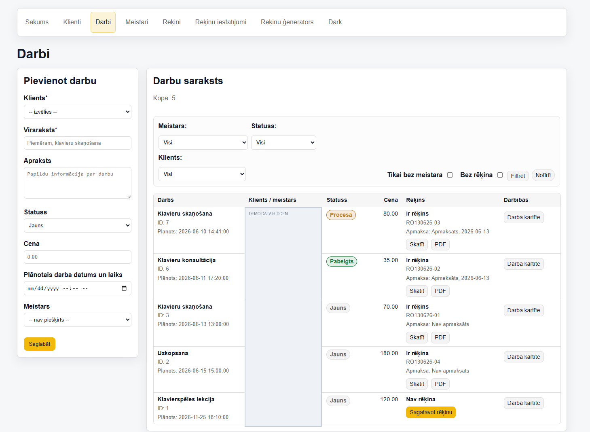
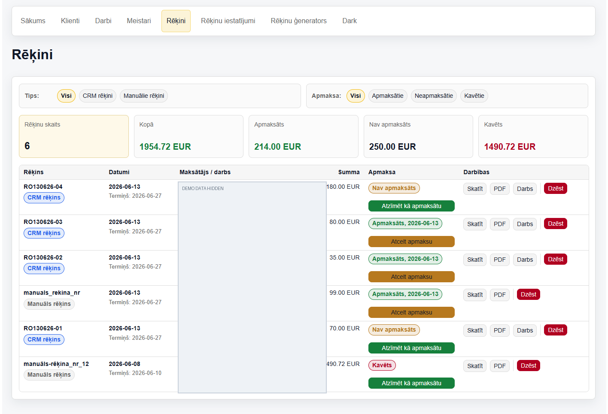
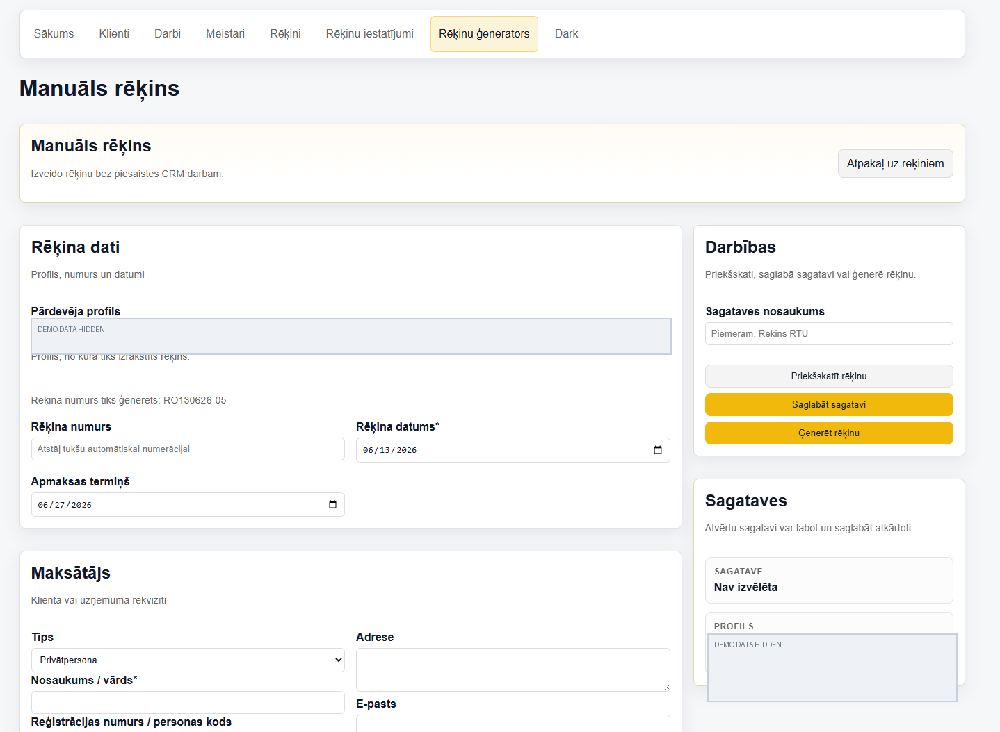

# Service Business CRM & Invoice Manager

**Qualification project · PHP 8.1+ · MySQL/MariaDB · PDO · JavaScript · Dompdf**

A PHP/MySQL business management prototype for service businesses: clients, jobs, contractors, invoice creation, PDF export and payment-status tracking in one application. Built with server-rendered PHP and a simplified MVC architecture.

Designed and implemented by **Ronalds Gigelis** as a programming technician qualification project (2026). This is a **local demonstration prototype, not production software**.

[Latviski](#latviski) · [Features](#features) · [Screenshots](#screenshots) · [Run locally](#run-locally) · [Project documents](#project-documents)

## Screenshots

Actual screenshots of the developed application. Personal/contact details are masked in this public portfolio edition; the figures shown are demonstration data.

| Dashboard | Jobs, filters & statuses |
|:---:|:---:|
| [](screenshots/dashboard.png) | [](screenshots/jobs.png) |
| **Invoice management** | **Manual invoice generator** |
| [](screenshots/invoices.png) | [](screenshots/manual-invoice.png) |

## Features

- **Clients:** add, view, edit and delete client records.
- **Masters/contractors:** manage contacts; view assigned work via a token-based page.
- **Jobs:** create and edit work orders, assign clients and masters, change statuses and filter lists.
- **Dashboard:** overview of jobs, invoices, unpaid items and recent activity.
- **Invoices:** generate an invoice from a job or create one manually, using seller profiles and configurable numbering.
- **PDF:** preview and export invoices with Dompdf.
- **Payments:** manually record paid/unpaid status and see overdue invoices; there is **no payment gateway**.
- **Interface:** light/dark theme and basic responsive layout.

The CRM is intentionally limited in scope for the qualification demonstration. Authentication, role-based authorization, CSRF protection and fuller payment history are **not yet implemented**.

## Technology

| Layer | Implementation |
|---|---|
| Application | PHP 8.1+, server-rendered pages, simplified MVC structure |
| Database | MySQL/MariaDB, PDO |
| Frontend | HTML, CSS, JavaScript |
| PDF generation | Dompdf |
| Dependencies | Composer |
| Development/demo | Git, XAMPP (Apache + MySQL/MariaDB) |

### Architecture and database

The front controller `public/index.php` routes requests to PHP controllers. Controllers coordinate database access through PDO and render the PHP views; invoice output uses Dompdf.

Core tables: `clients`, `masters`, `jobs`, `invoices`, `invoice_profiles`, `invoice_templates`.

## Run locally

**Requirements:** PHP 8.1+, MySQL/MariaDB, Composer. For logos in PDF invoices, enable the PHP **GD** extension. This project has been prepared for local XAMPP demonstration.

1. Clone or download this repository into `C:\xampp\htdocs\crm` (or an equivalent web-server directory).
2. In the **project root**, install Composer dependencies:

   ```bash
   composer install
   ```

3. Start **Apache** and **MySQL** in XAMPP.
4. In phpMyAdmin, import **one** of the two standalone SQL setup files:
   - `sql/demo_setup.sql` — database schema plus prepared sample records (**recommended for a quick demo**).
   - `sql/full_setup.sql` — empty CRM structure, without sample records.

   Both target the database named `crm`. Use a fresh/test database: importing setup SQL into an existing database can overwrite data.
5. If necessary, set the local MySQL host, database name, username and password in `app/config.php`.
6. Open **http://localhost/crm/public/** in a browser.

Alternatively, from the project root, after the database is running:

```bash
php -S localhost:8081 -t public
```

Then open **http://localhost:8081/**.

For full installation notes see **[sql/README_IMPORT.md](sql/README_IMPORT.md)**. The additional SQL files in `sql/` are historical/incremental migrations; they are **not** all required after importing a complete setup file.

> **Note:** the `vendor/` directory is intentionally excluded from Git and is restored by `composer install`. Uploaded invoice logos in `public/uploads/` are not tracked; for a custom logo, add it again through the CRM invoice settings. Do not commit credentials or real customer records.

## Demonstration checklist

- Open dashboard and confirm the sample counts.
- Add and edit a client, contractor and job.
- Filter jobs, change job status and assign a contractor.
- Generate an invoice from a job and export it as PDF.
- Create a manual invoice, use a saved template and preview it.
- Change an invoice payment status and use the overdue filters.
- Toggle light/dark mode.

These describe manual testing scenarios, **not automated test coverage**.

## Project documents

The GitHub portfolio includes the written qualification materials:

- **[Qualification documentation — DOCX](docs/qualification-documentation-public.docx)** (126-page technical report)
- **[Defense presentation — PPTX](docs/defense-presentation-public.pptx)** (13 slides)
- **[Source code appendix — DOCX](pirmkods_pielikums.docx)**

These are **public portfolio copies**. Screenshots with personal or company contact details have been redacted. The originals submitted for the qualification defense were left unchanged.

## Limitations and security

**Do not expose this prototype directly to the public internet or use it with real customer data.**

- User authentication and permissions are outside the current scope.
- CSRF protection and production security hardening are not complete.
- Token-based master pages should not be treated as a complete authorization system.
- Payment statuses are manually managed; no banking/payment integrations.
- This repository is a coursework/qualification deliverable, not an actively supported commercial CRM product.

## Repository structure

```text
app/                 Controllers, routes, configuration, PDO
public/              Front controller, CSS/JS and web assets
views/               PHP templates
sql/                 Standalone setup files and migrations
screenshots/         Anonymized CRM interface images
docs/                Public copies of qualification documents
composer.json        PHP dependencies
README.md            Project overview and quick start
```

## Latviski

**Kvalifikācijas darba tēma:** “CRM sistēmas prototipa izstrāde pakalpojumu uzņēmuma darbu un rēķinu pārvaldībai”.

Izstrādāts PHP/MySQL CRM prototips klientu, meistaru, darbu un rēķinu pārvaldībai. Sistēma paredzēta lokālai demonstrācijai, izmantojot XAMPP un sagatavotus demonstrācijas datus. Projekts atbalsta rēķinu ģenerēšanu no darba, manuālus rēķinus, PDF eksportu, statusu un filtru pārvaldību. Tā nav gatava produkcijas videi bez autentifikācijas, piekļuves tiesībām un citiem drošības uzlabojumiem.

**Palaišana:** `composer install` → XAMPP Apache/MySQL → `sql/demo_setup.sql` imports → `http://localhost/crm/public/`.

Pilnā dokumentācija un prezentācija atrodas mapē **[docs/](docs/)**.

---

**Author:** Ronalds Gigelis · 2026

**License:** No open-source license is granted at present. The source is public for evaluation/portfolio review; redistribution or use in other projects requires permission from the copyright holder.
